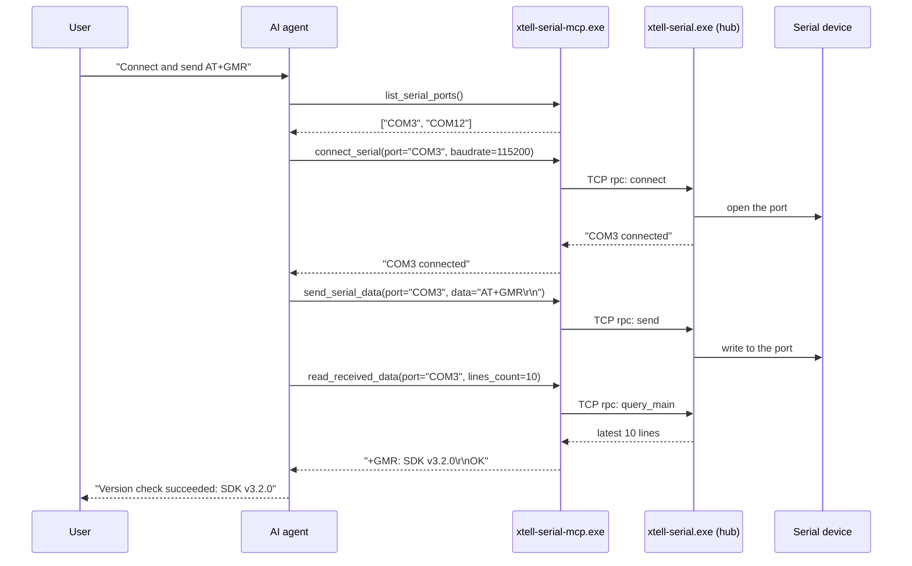

# xtell-serial MCP Server: setup and tool reference

For **AI agents** (Claude Code, Cursor, Windsurf, Antigravity, Cline and similar) and for **developers**. It explains how to connect `xtell-serial` to a language model so it can drive a serial port in natural language.

[中文版](MCP_SETUP.zh-CN.md)

---

## 0. Architecture in 30 seconds

Two executables are built (see the main README):

| Executable | Role | Mode | How it is used |
|---|---|---|---|
| **`xtell-serial.exe`** | Serial terminal GUI **and** local TCP hub | Windowed | Opened by a person, or started automatically by the MCP server. The first window to start listens on `127.0.0.1:50016` and acts as the hub. |
| **`xtell-serial-mcp.exe`** | MCP stdio server | Console / stdio | Started by the AI client in the background. It talks to the model over stdio and forwards each call to the GUI over TCP. |

> **Golden rule: register `xtell-serial-mcp.exe` with your AI client, never `xtell-serial.exe`.**
> The GUI has no stdio pipe. Registering it makes the client hang or time out.

---

## 1. Quick setup for AI agents

If you are an AI agent and have been given a folder containing this file, locate the absolute path of `xtell-serial-mcp.exe` (for example `C:\path\to\xtell-serial-mcp.exe`) and write the MCP configuration for the host you are running in.

### Claude Code (CLI)

```bash
claude mcp add xtell-serial C:\path\to\xtell-serial-mcp.exe
```

Or add an `mcpServers` entry to `~/.claude.json`.

### Claude Desktop

Config file: `%APPDATA%\Claude\claude_desktop_config.json`

```json
{
  "mcpServers": {
    "xtell-serial": {
      "command": "C:\\path\\to\\xtell-serial-mcp.exe",
      "args": []
    }
  }
}
```

### Cursor / Windsurf

Put the same JSON in `.mcp.json` at the project root.

### VS Code (Cline / Roo Code)

Add the same JSON to the extension's MCP settings file (for Cline on Windows this is usually under `%APPDATA%\Code\User\globalStorage\`, in the extension's `settings` folder).

### Antigravity IDE (Gemini)

- Global: `%USERPROFILE%\.gemini\config\mcp_config.json`
- Per project: `<project root>\.agents\mcp_config.json`

Use the same JSON.

Restart the client after saving the configuration.

---

## 2. The 14 MCP tools

### 2.1 Ports and connections

#### `list_serial_ports`
- Scans the computer for serial ports and returns a list such as `["COM1", "COM3"]`.
- Parameters: none.
- Works even when the GUI is not running (the MCP server enumerates ports locally as a fallback).

#### `connect_serial`
- Connects the given port at the given baud rate. If there is no free window, the GUI opens a new one for the port.
- Parameters:
  - `port` (*string*, required): port name, for example `"COM3"`
  - `baudrate` (*integer*, required): for example `115200`

#### `disconnect_serial`
- Disconnects a port.
- Parameters:
  - `port` (*string*, required)

### 2.2 Sending data

#### `send_serial_data`
- Sends one message to a port, as text or as hexadecimal bytes.
- Parameters:
  - `port` (*string*, required)
  - `data` (*string*, required): for example `"AT\r\n"` or `"AA BB CC 01"`
  - `hex_mode` (*boolean*, optional, default `false`): when `true`, `data` is parsed as hex

#### `start_auto_send`
- Starts repeating a message on a timer.
- Parameters:
  - `port` (*string*, required)
  - `data` (*string*, required)
  - `interval_ms` (*integer*, required, default `1000`): interval in milliseconds
  - `hex_mode` (*boolean*, optional, default `false`)

#### `stop_auto_send`
- Stops the repeating send.
- Parameters:
  - `port` (*string*, required)

### 2.3 Reading data

#### `read_received_data`
- Reads recent lines from the main receive window.
- Parameters:
  - `port` (*string*, required)
  - `lines_count` (*integer*, optional, default `50`): maximum number of lines
  - `start_time` (*string*, optional): start timestamp, format `yyyy-mm-dd HH:MM:SS.mmm`
  - `end_time` (*string*, optional): end timestamp

#### `read_sent_data`
- Reads the send history of a port.
- Parameters: same as `read_received_data`.

#### `read_filtered_data`
- Reads the lines that match the current filter.
- Parameters: same as `read_received_data`.

#### `get_buffer_status`
- Returns how many lines the window's buffer holds, its limit (100,000 lines by default) and the percentage used.
- Parameters:
  - `port` (*string*, required)

### 2.4 Filtering and saving

#### `set_filter`
- Sets the live filter of a window (substring or regular expression).
- Parameters:
  - `port` (*string*, required)
  - `keyword` (*string*, required): substring or regular expression
  - `is_regex` (*boolean*, optional, default `false`)
  - `enable` (*boolean*, optional, default `true`)

#### `start_saving_file`
- Continuously writes the data received on a port to a file on disk.
- Parameters:
  - `port` (*string*, required)
  - `filepath` (*string*, required): absolute path, for example `"C:/logs/uart_20261012.log"`

#### `stop_saving_file`
- Stops saving to the file.
- Parameters:
  - `port` (*string*, required)

#### `clear_data_buffers`
- Clears the text buffers of a window.
- Parameters:
  - `port` (*string*, required)
  - `target` (*string*, optional, default `"all"`): `"main"` (receive window), `"filter"` (filtered view), `"history"` (send history) or `"all"`

---

## 3. Typical workflow

For a request like *"connect to the board, send an AT command and check that it answers OK"*:



---

## 4. Ports and networking

- Default hub address: `127.0.0.1:50016`. The hub binds to the loopback interface only.
- To change the port, set the environment variable `XTELL_SERIAL_HUB_PORT` (for example `50018`). Both the GUI and the MCP server read it.

---

## 5. Troubleshooting

### The AI reports that the GUI must be opened first
- Cause: `xtell-serial.exe` is not running, so the hub port is not listening.
- Fix: start `xtell-serial.exe`, or let the AI call `connect_serial`, which tries to start the GUI itself.

### `MCP server timeout` or a communication failure
- Cause: most often `command` points at `xtell-serial.exe` instead of `xtell-serial-mcp.exe`, or a firewall blocks loopback connections.
- Fix: check that `command` is `xtell-serial-mcp.exe`.

### "No window is managing port COMx"
- Cause: that port has not been connected yet.
- Fix: call `connect_serial(port="COMx", baudrate=...)` first, then send or read.

---

Built by [XTELL](https://www.xtell.cn/).
