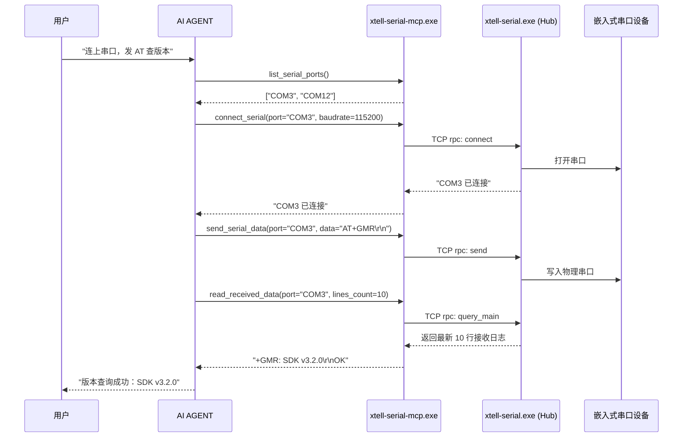

# xtell-serial MCP Server 配置与使用指南 (针对 AI AGENT 与开发者)

本文档面向 **AI AGENT**（如 Claude Code、Cursor、Windsurf、Antigravity、Cline 等）以及 **开发者**，提供将 `xtell-serial` 接入大模型并实现自然语言全自动控制串口调试的完整说明。

---

## 0. 核心架构与角色分工（30 秒搞懂）

发布包中包含两个核心可执行文件（BIN）：

| 可执行文件 | 角色定位 | 运行模式 | 如何使用 |
|---|---|---|---|
| **`xtell-serial.exe`** | **串口调试 GUI + TCP Hub** | 有图形界面（Windowed） | **人工双击打开** 或由 MCP 自动拉起。第一个打开的窗口自动监听 `127.0.0.1:50016` 作为 Hub。 |
| **`xtell-serial-mcp.exe`** | **MCP Stdio Server** | 纯命令行（Console / Stdio） | **专供 AI 客户端调用**。由 AI 宿主软件自动在后台拉起，通过 Stdio 与大模型通信，通过 TCP 将指令转发给 GUI。 |

> [!CRITICAL]
> **黄金法则：配置给 AI 客户端的必须是 `xtell-serial-mcp.exe`，绝不能是 `xtell-serial.exe`！**
> `xtell-serial.exe` 是图形程序，没有 Stdio 管道，若配置进 MCP 会导致 AI 客户端通信挂死或超时报错。

---

## 1. AI AGENT 快速自动配置指南

如果你是 **AI AGENT**，并且接收到了包含本文件的目录，请按照以下宿主环境路径，自动定位并写入 MCP 配置。

### 1.1 确定 `xtell-serial-mcp.exe` 的绝对路径
假设当前所在目录为 `C:\path\to\public`，则 MCP 启动命令路径为：
`C:\path\to\public\xtell-serial-mcp.exe`

### 1.2 各宿主软件配置文件路径与 JSON 格式

#### A. Antigravity IDE (Gemini)
- **全局配置文件**：`%USERPROFILE%\.gemini\config\mcp_config.json`
- **项目级配置文件**：`<项目根目录>\.agents\mcp_config.json`
- **配置内容**：
```json
{
  "mcpServers": {
    "xtell-serial": {
      "command": "C:\\path\\to\\public\\xtell-serial-mcp.exe",
      "args": []
    }
  }
}
```

#### B. Claude Desktop
- **配置文件路径**：`%APPDATA%\Claude\claude_desktop_config.json`
- **配置内容**：
```json
{
  "mcpServers": {
    "xtell-serial": {
      "command": "C:\\path\\to\\public\\xtell-serial-mcp.exe",
      "args": []
    }
  }
}
```

#### C. Claude Code (CLI)
- **直接运行命令行注册**：
```bash
claude mcp add xtell-serial C:\path\to\public\xtell-serial-mcp.exe
```
- 或在用户目录 `~/.claude.json` 中添加相应的 `mcpServers` 项。

#### D. Cursor / Windsurf
- **项目根目录**：`.mcp.json`
```json
{
  "mcpServers": {
    "xtell-serial": {
      "command": "C:\\path\\to\\public\\xtell-serial-mcp.exe",
      "args": []
    }
  }
}
```

#### E. VS Code (Cline / Roo Code)
- **配置文件**：`%APPDATA%\Code\User\globalStorage\rooveterinaryinc.roo-cline\settings\cline_mcp_settings.json`（或对应插件设置文件）
```json
{
  "mcpServers": {
    "xtell-serial": {
      "command": "C:\\path\\to\\public\\xtell-serial-mcp.exe",
      "args": []
    }
  }
}
```

---

## 2. 支持的 14 个 MCP 工具完整接口说明

`xtell-serial-mcp.exe` 注册后，AI AGENT 可以调用以下 14 项工具：

### 2.1 端口与连接管理

#### `list_serial_ports`
- **描述**：扫描电脑当前所有物理串口，返回可用串口号列表（例如 `["COM1", "COM3"]`）。
- **参数**：无。
- **特性**：即使 GUI 尚未启动，该工具亦具备本地枚举串口的兜底能力，随时可调。

#### `connect_serial`
- **描述**：连接指定串口与波特率。若当前没有空闲窗口，GUI 会自动新建窗口并打开该串口。
- **参数**：
  - `port` (*string*, 必填): 串口名，如 `"COM3"`
  - `baudrate` (*integer*, 必填): 波特率，如 `115200`

#### `disconnect_serial`
- **描述**：断开指定串口的连接。
- **参数**：
  - `port` (*string*, 必填): 串口名，如 `"COM3"`

---

### 2.2 数据发送控制

#### `send_serial_data`
- **描述**：向指定串口发送单条数据。支持常规文本和十六进制 HEX。
- **参数**：
  - `port` (*string*, 必填): 串口名
  - `data` (*string*, 必填): 发送内容，如 `"AT\r\n"` 或 `"AA BB CC 01"`
  - `hex_mode` (*boolean*, 可选, 默认 `false`): 为 `true` 时按 HEX 解析发送

#### `start_auto_send`
- **描述**：开启 GUI 定时循环自动发送。
- **参数**：
  - `port` (*string*, 必填): 串口名
  - `data` (*string*, 必填): 发送内容
  - `interval_ms` (*integer*, 必填, 默认 `1000`): 发送间隔（毫秒）
  - `hex_mode` (*boolean*, 可选, 默认 `false`): 是否 HEX 发送

#### `stop_auto_send`
- **描述**：停止定时自动发送。
- **参数**：
  - `port` (*string*, 必填): 串口名

---

### 2.3 数据读取与日志审计

#### `read_received_data`
- **描述**：从串口主接收窗口抓取最近的数据记录。
- **参数**：
  - `port` (*string*, 必填): 串口名
  - `lines_count` (*integer*, 可选, 默认 `50`): 读取的最大行数
  - `start_time` (*string*, 可选): 起始时间戳，格式 `yyyy-mm-dd HH:MM:SS.mmm`
  - `end_time` (*string*, 可选): 截止时间戳

#### `read_sent_data`
- **描述**：读取该串口的历史发送记录。
- **参数**：
  - `port` (*string*, 必填): 串口名
  - `lines_count` (*integer*, 可选, 默认 `50`): 读取的最大行数
  - `start_time` (*string*, 可选): 起始时间戳
  - `end_time` (*string*, 可选): 截止时间戳

#### `read_filtered_data`
- **描述**：读取命中当前过滤规则的数据记录。
- **参数**：
  - `port` (*string*, 必填): 串口名
  - `lines_count` (*integer*, 可选, 默认 `50`): 读取的最大行数
  - `start_time` (*string*, 可选): 起始时间戳
  - `end_time` (*string*, 可选): 截止时间戳

#### `get_buffer_status`
- **描述**：查询当前串口对应窗口的缓冲区行数使用情况、上限（默认 100,000 行）及占用百分比。
- **参数**：
  - `port` (*string*, 必填): 串口名

---

### 2.4 过滤与文件持久化

#### `set_filter`
- **描述**：为 GUI 窗口设置实时过滤规则（字符串包含或正则表达式匹配）。
- **参数**：
  - `port` (*string*, 必填): 串口名
  - `keyword` (*string*, 必填): 过滤关键字或正则表达式
  - `is_regex` (*boolean*, 可选, 默认 `false`): 是否作为正则表达式解析
  - `enable` (*boolean*, 可选, 默认 `true`): 是否激活过滤

#### `start_saving_file`
- **描述**：开启将指定串口的实时接收数据持续写入本地磁盘文件。
- **参数**：
  - `port` (*string*, 必填): 串口名
  - `filepath` (*string*, 必填): 保存文件的绝对路径，如 `"C:/logs/uart_20261012.log"`

#### `stop_saving_file`
- **描述**：停止向本地文件保存数据。
- **参数**：
  - `port` (*string*, 必填): 串口名

#### `clear_data_buffers`
- **描述**：清空 GUI 界面上的文本缓冲区。
- **参数**：
  - `port` (*string*, 必填): 串口名
  - `target` (*string*, 可选, 默认 `"all"`): `"main"`（接收窗口）, `"filter"`（过滤窗口）, `"history"`（发送历史）, 或 `"all"`（全部）

---

## 3. AI AGENT 典型交互工作流

AI AGENT 在接到用户命令（如“帮我连上板子发个 AT 指令，确认是否返回 OK”）时，推荐的标准时序如下：



---

## 4. 端口与网络避让说明

- **默认端口**：`127.0.0.1:50016`。
- **端口自定义**：如需变更端口，可设置环境变量 `XTELL_SERIAL_HUB_PORT`（例如设置为 `50008`），GUI 与 MCP 服务端均会自动读取并适配。

---

## 5. 常见排错与自愈指南 (FAQ)

> 注：MCP 服务端返回给 AI 的提示文字统一为英文，下面括号里是中文含义。

### Q1: AI 调用工具时提示 `No running xtell-serial was found ...`（未检测到运行中的 xtell-serial）
- **原因**：当前电脑上没有运行 `xtell-serial.exe`，TCP Hub 端口 `50016` 未就绪。
- **解决办法**：双击运行发布包中的 `xtell-serial.exe`，或者 AI 可以直接调用 `connect_serial` 工具，适配层会自动尝试唤起 GUI 进程。

### Q2: AI 提示 `MCP server timeout` 或通信失败
- **原因**：大概率将 `command` 错配成了 `xtell-serial.exe`，或者防火墙拦截了 `127.0.0.1` 回环连接。
- **解决办法**：确认配置文件中的 `command` 指向的是 `xtell-serial-mcp.exe`。

### Q3: 提示 `No window is managing COMx`（当前没有窗口在管理该串口）
- **原因**：尚未对该串口执行连接操作。
- **解决办法**：先调用 `connect_serial(port="COMx", baudrate=...)` 完成连接，再执行收发指令。

---

© 深圳市极智未来科技有限公司 (https://www.xtell.cn/)
